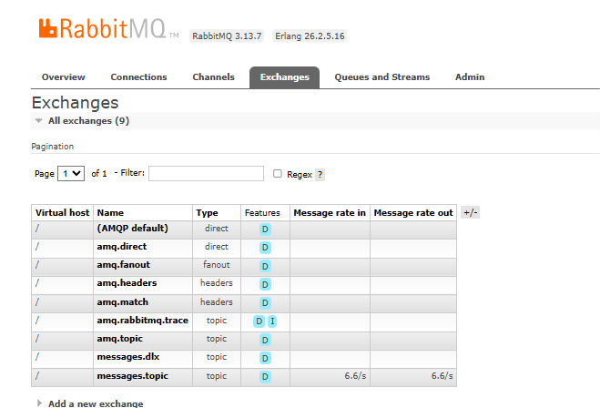
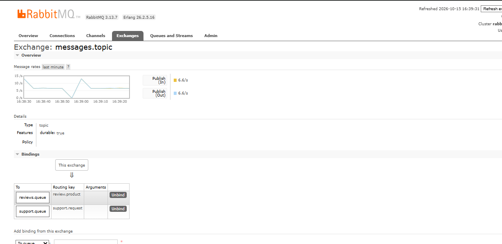
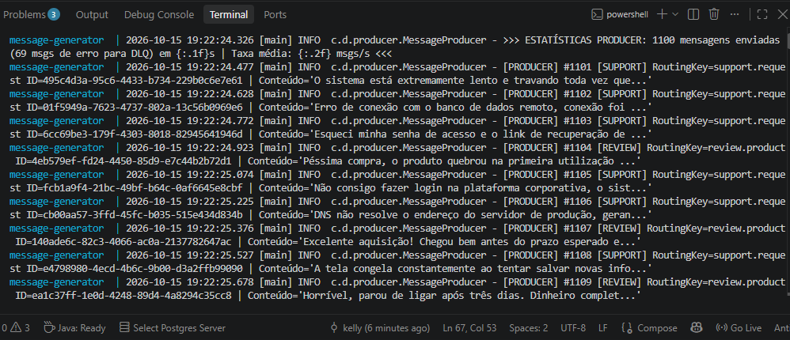
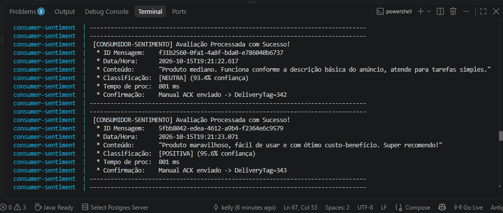
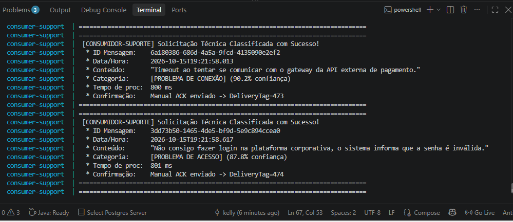
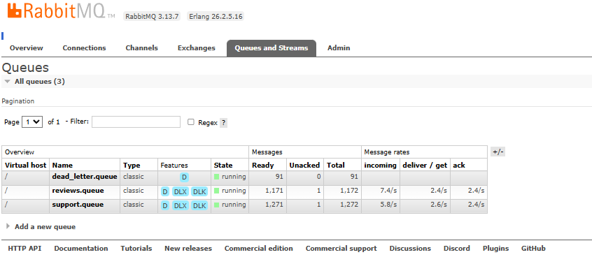
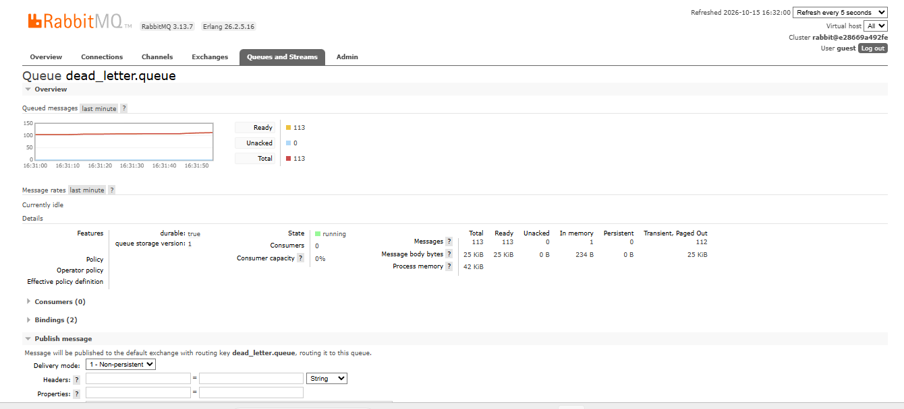

# Sistema Distribuído de Classificação Inteligente de Mensagens

Sistema distribuído desenvolvido em **Java 17**, **Docker Compose**, **RabbitMQ** (Topic Exchange, Dead Letter Queue e Manual ACK) e **Inteligência Artificial (Smile)** para classificação automática de mensagens via Processamento de Linguagem Natural (NLP).

> 📺 **Vídeo de Demonstração do Projeto:** [Assista no YouTube (https://youtu.be/8XTMWBmj4_M)](https://youtu.be/8XTMWBmj4_M)

---

## 🚀 Como Executar o Projeto (Passo a Passo)

### Pré-requisito
- Ter apenas o **Docker Desktop** instalado e em execução (não é necessário instalar Java ou Maven na máquina host).

### 1. Iniciar os Containers
Na raiz do projeto, execute o comando:
```bash
docker compose up --build
```
> O Docker compilará a aplicação em Java 17, empacotará o JAR com as dependências do RabbitMQ e Smile, e iniciará os 4 containers na mesma rede.

### 2. Acessar o Painel de Gerenciamento do RabbitMQ
Abra o navegador no endereço:
- **URL:** [http://localhost:15672](http://localhost:15672)
- **Usuário:** `guest`
- **Senha:** `guest`

### 3. Comandos Úteis
- **Executar em segundo plano (modo detached):**
  ```bash
  docker compose up --build -d
  ```
- **Acompanhar os logs em tempo real:**
  ```bash
  docker compose logs -f
  ```
- **Ver logs apenas de um serviço específico:**
  ```bash
  docker compose logs -f consumer-sentiment
  docker compose logs -f consumer-support
  docker compose logs -f message-generator
  ```
- **Parar e remover todos os containers:**
  ```bash
  docker compose down
  ```

---

## 🏛️ Arquitetura e Topologia de Mensageria (RabbitMQ)

O fluxo de comunicação assíncrono entre os componentes obedece à seguinte arquitetura:

```
                        +----------------------------------+
                        |   Container 1: Gerador (Java)    |
                        |   Taxa: >= 5 mensagens/segundo   |
                        +-----------------+----------------+
                                          |
                                          | publica via AMQP (JSON)
                                          v
                        +-----------------+----------------+
                        |  Container 2: Broker RabbitMQ    |
                        |   Exchange: messages.topic       |
                        +--------+----------------+--------+
                                 |                |
             review.product      |                | support.request
                                 v                v
                         +---------------+  +---------------+
                         | reviews.queue |  | support.queue |
                         +-------+-------+  +-------+-------+
                                 |                  |
               Manual ACK após   v                  v  Manual ACK / basicNack (requeue=false)
                         +---------------+  +---------------+
                         |  Container 3  |  |  Container 4  |
                         |  Consumidor 1 |  |  Consumidor 2 |
                         | (Sentimento)  |  |   (Suporte)   |
                         +---------------+  +-------+-------+
                                                    | (em caso de erro)
                                                    v
                                            +---------------+
                                            | messages.dlx  |
                                            +-------+-------+
                                                    | routing key: #
                                                    v
                                            +---------------+
                                            | dead_letter.  |
                                            |     queue     |
                                            +---------------+
```

### Configuração das Exchanges
A listagem exibe as exchanges criadas para o sistema, evidenciando as exchanges `messages.dlx` e `messages.topic`, ambas corretamente configuradas com o Type "topic":



### Regras de Roteamento (Bindings) da Topic Exchange
A seção de "Bindings" na parte inferior da imagem evidencia as regras de roteamento, mostrando explicitamente que a chave `review.product` encaminha mensagens para a `reviews.queue` e a chave `support.request` encaminha para a `support.queue`:



---

## 📦 Execução dos Contêineres e Logs do Terminal

### 1. `message-generator` (Container 1 - Produtor Java)
Demonstração da produção das mensagens no terminal. Os logs detalham o envio de mensagens do tipo `[SUPPORT]` usando a routing key `support.request` e mensagens `[REVIEW]` com a routing key `review.product`, incluindo também uma mensagem de estatística com a contagem total de envios e a quantidade de falhas simuladas direcionadas à DLQ:



### 2. `consumer-sentiment` (Container 3 - Consumidor 1: Análise de Sentimento)
Logs de execução do contêiner `consumer-sentiment`. A tela exibe o processamento bem-sucedido de avaliações de produtos, detalhando o ID da mensagem, data/hora, o conteúdo do texto, a classificação de sentimento gerada pela IA (como NEUTRA e POSITIVA, acompanhada da porcentagem de confiança), o tempo de processamento de aproximadamente 801 ms, e a confirmação de recebimento através do envio do Manual ACK:



### 3. `consumer-support` (Container 4 - Consumidor 2: Classificação de Suporte)
Logs do contêiner `consumer-support` exibindo solicitações técnicas sendo classificadas com sucesso, listando o ID, o conteúdo do problema relatado, a categoria classificada pela IA (como PROBLEMA DE CONEXÃO e PROBLEMA DE ACESSO), o tempo de processamento e a confirmação via Manual ACK:



---

## 📊 Monitoramento de Filas e Dead Letter Queue (DLQ)

### Visão Geral das Filas e Demonstração do Gargalo
Tela da aba "Queues" (Filas) no painel do RabbitMQ, listando a visão geral de todas as três filas criadas para o projeto. A imagem comprova o gargalo intencional das filas, mostrando 1.171 mensagens retidas na `reviews.queue`, 1.271 mensagens retidas na `support.queue`, e 91 mensagens na `dead_letter.queue`:



### Detalhamento da Fila de Mensagens Mortas (`dead_letter.queue`)
Captura da interface de gerenciamento do RabbitMQ focada na visualização detalhada da fila `dead_letter.queue`. O gráfico e as estatísticas da página comprovam que a fila de mensagens mortas acumulou 113 mensagens com o status "Ready":



---

## 🧠 Modelo de Inteligência Artificial (Smile)

Para a classificação de texto em linguagem natural, foi utilizada a biblioteca **Smile (Statistical Machine Intelligence and Learning Engine)**:

1. **Pré-processamento (`TextClassifier.java`)**:
   - Conversão para minúsculas, remoção de acentos via normalização Unicode (NFD) e remoção de pontuações via Regex.
   - Tokenização e filtragem de termos curtos.
2. **Vetorização (Bag-of-Words Normalizado)**:
   - Construção de vocabulário e contagem de termos por mensagem.
   - Aplicação de **Normalização Euclidiana ($L_2$)** no vetor de frequências para eliminar distorções causadas pelo tamanho do texto.
3. **Classificação Supervisionada K-NN (`smile.classification.KNN`)**:
   - O algoritmo calcula a distância euclidiana para os vizinhos mais próximos ($k=3$), inferindo a categoria com precisão e rapidez.

---

## 📂 Estrutura de Pastas

```text
Trabalho-SD-05/
├── docker-compose.yml              # Orquestração dos 4 serviços
├── Dockerfile                      # Multi-stage build (Maven + JRE 17 Alpine)
├── pom.xml                         # Dependências (RabbitMQ, Smile, Jackson, Logback)
├── README.md                       # Instruções de execução e documentação ilustrada
├── .dockerignore                   # Arquivos ignorados no build
├── images/                         # Capturas de tela e evidências de execução
│   ├── consumer-sentiment.png
│   ├── consumer-support.png
│   ├── dead_letter.png
│   ├── exchanges.png
│   ├── filas.png
│   ├── message-generator.png
│   └── messages-topic.png
└── src/
    └── main/
        ├── java/
        │   └── com/
        │       └── distribuidos/
        │           ├── model/
        │           │   ├── Message.java          # Entidade de dados (UUID, timestamp, tipo, conteúdo)
        │           │   └── MessageType.java      # Enum REVIEW e SUPPORT
        │           ├── config/
        │           │   └── RabbitMQConfig.java   # Topologia (Topic, DLQ, Filas) e conexão resiliente
        │           ├── ai/
        │           │   ├── TextClassifier.java   # Vetorizador Bag-of-Words e Smile K-NN
        │           │   ├── SentimentModel.java   # Modelo de Análise de Sentimento
        │           │   └── SupportModel.java     # Modelo de Classificação de Suporte
        │           ├── producer/
        │           │   └── MessageProducer.java  # Gerador contínuo de mensagens
        │           └── consumer/
        │               ├── sentiment/
        │               │   └── SentimentConsumer.java  # Consumidor de Sentimento (Manual ACK)
        │               └── support/
        │                   └── SupportConsumer.java    # Consumidor de Suporte (DLQ + Manual ACK)
        └── resources/
            └── logback.xml         # Configuração de logs
```
